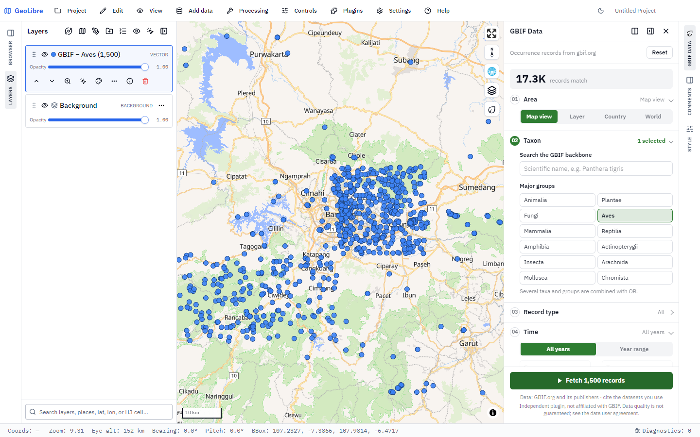
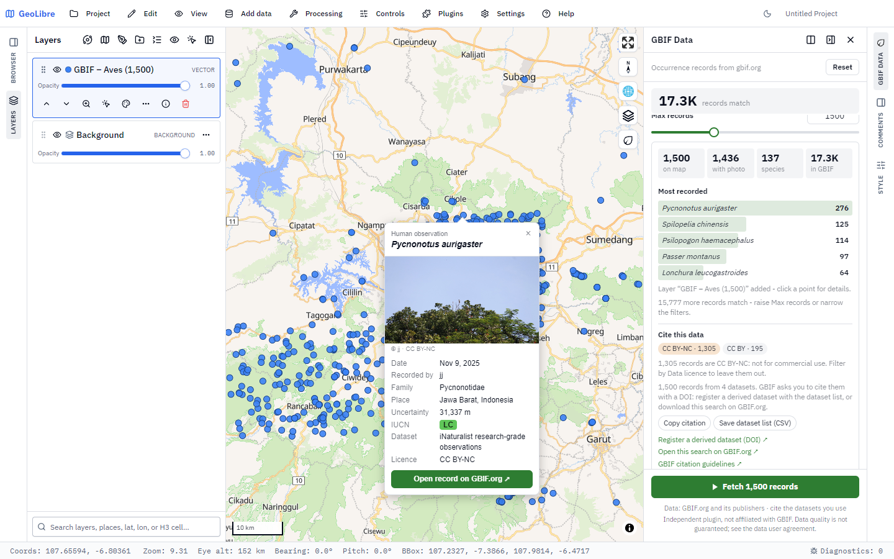
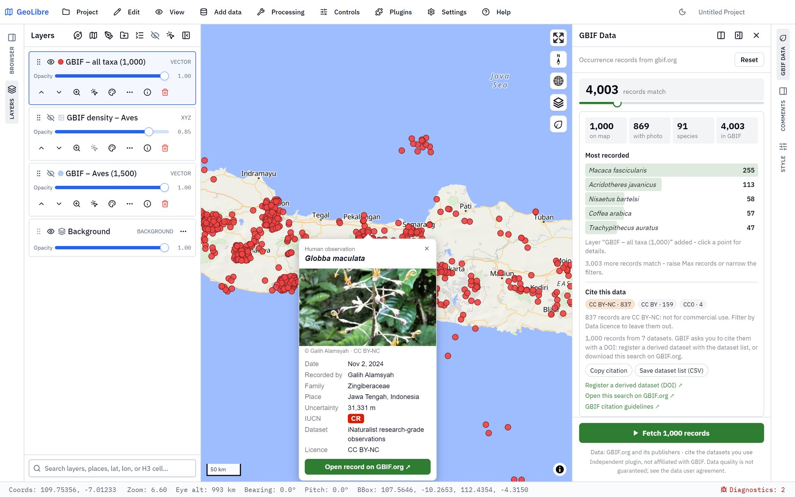
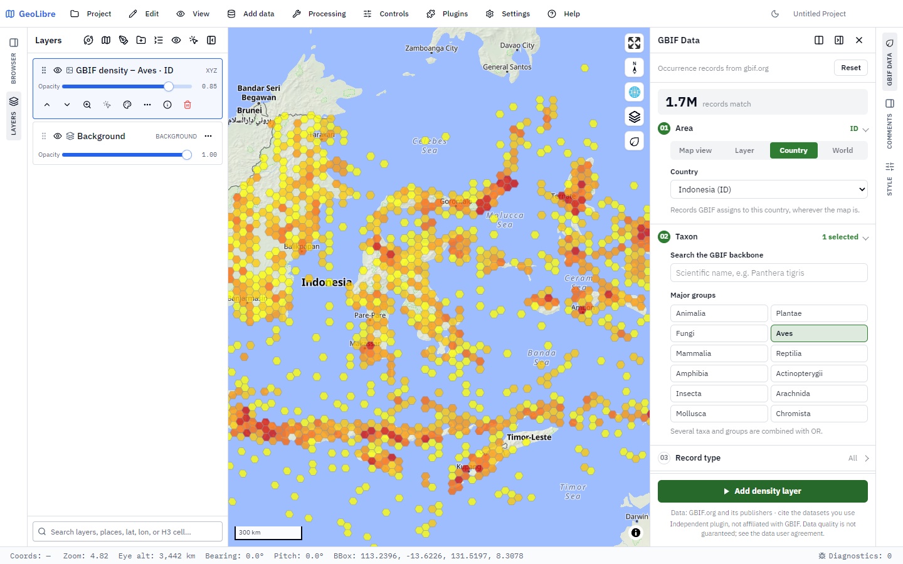

# GBIF Data — GeoLibre plugin


Fetch georeferenced occurrence records from the
[Global Biodiversity Information Facility](https://www.gbif.org) straight onto
the GeoLibre map. 

> **Independent project.** This is a community plugin, made out of
> appreciation for GBIF's open data. It is **not** made, affiliated with,
> sponsored or endorsed by GBIF. "GBIF" names the data source only; the plugin
> uses no GBIF logo. The data belong to their publishers and come with no
> guarantee of quality or completeness — see the
> [GBIF data user agreement](https://www.gbif.org/terms/data-user).

> **Ringkasan (Bahasa Indonesia)** — Plugin GeoLibre untuk mengambil data
> kemunculan (occurrence) spesies dari GBIF langsung ke peta. Filter
> berdasarkan area (tampilan peta, extent layer, negara, atau seluruh dunia),
> takson, jenis rekaman, tahun, kualitas data, kategori IUCN, dan lainnya.
> Hasil bisa ditambahkan sebagai titik (GeoJSON, maks. 5.000 rekaman), sebagai
> layer kepadatan heksagon GBIF, atau keduanya. Klik titik untuk melihat
> detail dan foto rekaman. Plugin ini dibuat secara independen sebagai bentuk
> apresiasi, **bukan** produk resmi GBIF. Kartu "Cite this data" membantu
> mengutip data sesuai pedoman GBIF (daftar dataset untuk DOI *derived
> dataset*).

## Screenshots


*1,500 bird records around Bandung, West Java, added as a point layer. The
header counts every matching record in GBIF (17.3K); the numbered steps hold
the filters.*


*Clicking a point opens its record: photo with creator and licence, date,
recorder, family, place, uncertainty, IUCN category, dataset and licence. The
results card lists the most recorded species, and **Cite this data** shows the
licence mix (with a CC BY-NC warning) and the citation tools.*


*Quality → IUCN Red List **CR, EN, VU** over Java: 4,003 records of 91 threatened
species. The popup of *Globba maculata* (Critically Endangered) shows the red IUCN
badge, the generalised location (31 km uncertainty) and the photo's creator
and licence.*


*Density output for Area = Country (Indonesia): GBIF hexagon tiles of all 1.7
million matching bird records, without downloading them one by one.*

## Contents

- [Screenshots](#screenshots)
- [Features](#features)
- [Requirements](#requirements)
- [Install](#install)
- [Quick start](#quick-start)
- [The panel, step by step](#the-panel-step-by-step)
- [Output](#output)
- [Attribute columns](#attribute-columns)
- [Limits and defaults](#limits-and-defaults)
- [How it works](#how-it-works)
- [Troubleshooting](#troubleshooting)
- [Repository layout](#repository-layout)
- [Development](#development)
- [Tech stack](#tech-stack)
- [Data use and citation](#data-use-and-citation)
- [References](#references)
- [Privacy](#privacy)
- [Changelog](#changelog)
- [Licence](#licence)

## Features

- **Live counter** — the header shows how many GBIF records match the current
  filters (a `limit=0` request), and follows the map while the area is the
  map view.
- **01 Area** — map view, extent of a layer, a country (ISO code), or the whole
  world (only together with a narrowing filter).
- **02 Taxon** — search the GBIF backbone with suggestions (`species/suggest`,
  Enter falls back to `species/match`), pick several taxa, and/or one-click
  major groups (Animalia, Plantae, Fungi, Aves, Mammalia, ...). Everything
  selected is combined with OR.
- **03 Record type** — basis of record (human observation, preserved specimen,
  machine observation, ...).
- **04 Time** — all years or a year range, with presets.
- **05 Quality** — photos only, drop geospatial issues, presence records only,
  maximum coordinate uncertainty, IUCN Red List category, data licence (CC0,
  CC BY, CC BY-NC).
- **06 More filters** — recorded by, dataset key, institution code, keyword.
- **Add to map** as points (GeoJSON, up to 5,000 records), as GBIF hexagon
  density tiles (every matching record, via the ad-hoc map API), or both.
- **Results card** — records added, records with a photo, species count,
  total in GBIF, and the five most recorded species.
- **Cite this data** — licence breakdown of the fetched records (with a
  warning for CC BY-NC), **Copy citation**, **Save dataset list (CSV)** for
  registering a [derived dataset](https://www.gbif.org/derived-dataset/register)
  with a DOI, and a link to the same search on GBIF.org for a DOI-backed
  download. See [Data use and citation](#data-use-and-citation).
- **Popup** — click a point for its name, date, recorder, family, place,
  coordinate uncertainty, IUCN category, dataset (linked to its GBIF page),
  record licence and photo with its creator and licence, plus a link to the
  record on GBIF.org. The popup stays inside the map near the edges.
- **Active filter tags** — every filter in use shows as a removable chip above
  the Fetch button; **Reset** clears them all at once.
- **Polite to the API** — pages of 300 with a pause between them, a 5,000
  record cap, and automatic back-off when GBIF answers 429 / 503.
- **No API key, no dependencies** — a single self-contained ES module that
  talks to the public GBIF API directly.

## Requirements

- GeoLibre 3.0.0 or newer, MapLibre renderer.
- `addTileLayer` support in the host for the density output (points work
  without it).
- An internet connection that can reach `api.gbif.org` (and the photo hosts,
  for record images in the popup).

## Install

### From a release zip

Zip the three plugin files with `plugin.json` at the root of the zip:

```powershell
cd geolibre-gbif-data
Compress-Archive -Path plugin.json, index.js, style.css -DestinationPath ..\geolibre-gbif-data-1.1.0.zip
```

On macOS / Linux:

```bash
cd geolibre-gbif-data && zip ../geolibre-gbif-data-1.1.0.zip plugin.json index.js style.css
```

Then in GeoLibre: **Settings → Manage Plugins → Install from file** and pick
the zip. A ready-made (minified) zip is attached to each
[GitHub release](https://github.com/Defani/GBIF-Data/releases).

### From the marketplace

[`marketplace/registry-entry.json`](marketplace/registry-entry.json) is this
plugin's entry for the [GeoLibre plugin registry](https://github.com/opengeos/geolibre-plugins)
(`registry/geolibre-gbif-data.json` there), pointing at the release zip and
its SHA-256. Once it is listed, install the plugin from **Settings → Manage
Plugins** like any other.

## Quick start

1. Open the panel with the **leaf** button in the map's top-right toolbar (or
   the GBIF Data icon on the right panel rail).
2. Pan and zoom the map to the area you care about — **Area** defaults to
   *Map view*.
3. Under **Taxon**, type a scientific name (e.g. `Panthera tigris`) and pick
   it from the list, or click a major group such as **Aves**.
4. Watch the counter in the header update with the number of matching
   records.
5. Press **Fetch 500 records**. A point layer named
   `GBIF – <taxa> (<count>)` is added, and the results card lists the most
   recorded species.
6. Click any point to open its popup.

## The panel, step by step

| Step | What it sets | Notes |
| --- | --- | --- |
| **01 Area** | `decimalLatitude` / `decimalLongitude` ranges, or `country` | *Map view* follows the map. *Layer* uses the bounding box of a vector layer, not its exact shape. *Country* uses GBIF's country assignment, wherever the map is. *World* needs a taxon, dataset, recorder, institution or keyword. |
| **02 Taxon** | `taxonKey` (repeated) | Suggestions appear after 2 characters. Arrow keys + Enter pick a suggestion; Enter with nothing highlighted asks `species/match` for the best backbone match. Groups: Animalia, Plantae, Fungi, Aves, Mammalia, Reptilia, Amphibia, Actinopterygii, Insecta, Arachnida, Mollusca, Chromista. |
| **03 Record type** | `basisOfRecord` (repeated) | None selected = every type. |
| **04 Time** | `year` | Presets: last 5 years, last 10 years, since 2000, this year. A reversed range is swapped automatically. |
| **05 Quality** | `mediaType`, `hasGeospatialIssue`, `occurrenceStatus`, `coordinateUncertaintyInMeters`, `iucnRedListCategory`, `license` | *Drop geospatial issues* and *Presence records only* are on by default. An uncertainty limit (≤ 100 m, ≤ 1 km, ≤ 10 km) also drops records that don't state their uncertainty. IUCN: CR, EN, VU, NT, LC, DD. Data licence: CC0, CC BY, CC BY-NC (leave out CC BY-NC for commercial work). |
| **06 More filters** | `recordedBy`, `datasetKey`, `institutionCode`, `q` | Comma-, semicolon- or newline-separated lists for the first three. |

Within a step, multiple values are OR-ed; different steps are AND-ed.

## Output

Choose under **Add to map**:

- **Points** — fetches up to *Max records* (10–5,000, default 500) in pages of
  300 and adds a GeoJSON point layer. When the area is *Country* or *World*,
  the map zooms to the fetched records.
- **Density** — adds a raster tile layer from GBIF's ad-hoc map API
  (`classic.poly` style, hexagon bins, 40 hexagons per tile, 85 % opacity)
  that shows **every** matching record, not only the fetched ones. Nothing is
  downloaded record by record, so it is instant even for millions of records.
- **Both** — the density layer plus the point layer.

Points, counter and density tiles are built from the same filter parameters,
so they always describe the same set of records.

## Attribute columns

Every attribute is a flat column, so the attribute table and exports show one
value per column:

| Column | Meaning |
| --- | --- |
| `gbifKey` | GBIF occurrence key |
| `scientificName`, `species`, `vernacularName`, `taxonRank` | Name as interpreted by GBIF |
| `kingdom`, `phylum`, `class`, `order`, `family`, `genus` | Backbone classification |
| `taxonKey`, `speciesKey` | Backbone keys |
| `basisOfRecord` | Record type |
| `eventDate`, `year` | When it was recorded |
| `recordedBy` | Observer / collector |
| `country`, `countryCode`, `stateProvince`, `locality` | Where it was recorded |
| `uncertaintyM` | Coordinate uncertainty in metres |
| `iucnRedListCategory` | IUCN Red List category |
| `occurrenceStatus` | `PRESENT` / `ABSENT` |
| `datasetName`, `datasetKey`, `datasetUrl`, `institutionCode`, `publisher` | Source dataset, its GBIF page, and the publishing organisation key |
| `rightsHolder`, `occurrenceID` | Rights holder and the publisher's own record identifier |
| `license`, `licenseLabel` | Licence of the record (URL, and short label: CC0 / CC BY / CC BY-NC) |
| `imageCount`, `image`, `imageCreator`, `imageLicense` | First still image and its rights holder / licence |
| `gbifUrl` | Link to the record on GBIF.org |
| `accessed` | Date the record was fetched (YYYY-MM-DD), for citations |

The dataset key, publisher and licence stay on every record, as the GBIF data
user agreement asks for data shared onward — keep these columns when you
filter or export. Each feature also carries an internal `__gbifPlugin` flag
that the plugin uses to recognise its own points for the popup.

## Limits and defaults

| Setting | Value |
| --- | --- |
| Records per request | 300 (GBIF's ceiling) |
| Max records per fetch | 5,000 (default 500) |
| Pause between pages | 200 ms |
| Request timeout | 30 s (10 s for taxon search, 15 s for the counter) |
| Counter refresh | 450 ms after the last change or map move |
| Busy server (429 / 503) | Up to 3 retries, waiting `Retry-After` or 2 s, 4 s, 8 s |

The cap keeps the plugin polite to the public API. For larger or citable
extracts use a [GBIF download](https://www.gbif.org/occurrence/search), which
gets a DOI.

## How it works

GBIF endpoints used:

| Endpoint | Purpose |
| --- | --- |
| `GET /v1/occurrence/search` | Records (paged) and the live counter (`limit=0`) |
| `GET /v1/species/suggest` | Taxon autocomplete |
| `GET /v1/species/match` | Best backbone match on Enter |
| `GET /v2/map/occurrence/adhoc/{z}/{x}/{y}@1x.png` | Density tiles |

GeoLibre host API used: `getMap`, `addMapControl` / `removeMapControl`,
`registerRightPanel` (falls back to `registerFloatingPanel`),
`openRightPanel` / `openFloatingPanel`, `getViewBounds`, `listLayers`,
`getSelectedLayerId`, `getLayerFeatures`, `addGeoJsonLayer`, `addTileLayer`,
`fitBounds` and `getActiveMapTool` (the popup steps aside while Identify,
selection or GeoEditor own the click).

Other details:

- A map view wider than the world or crossing the antimeridian drops the
  longitude range instead of sending an inverted one.
- iNaturalist photos (the biggest photo source in GBIF) are shown in their
  *medium* rendition rather than the full-size original.
- All panel and popup content is built through the DOM API, never
  `innerHTML`, so nothing from an API response is parsed as markup.
- The popup is a plain DOM overlay positioned with `map.project()`, so the
  plugin needs no copy of `maplibre-gl`.
- Deactivating the plugin cancels a running fetch and removes the control,
  panel, popup and map listeners.

## Troubleshooting

| Message | What to do |
| --- | --- |
| *A world search needs a taxon, dataset, recorder, institution or keyword.* | Add a narrowing filter, or pick another Area. |
| *That layer has no vector features to take an extent from* | Raster and tile layers have no extent to read — pick a vector layer or use Map view. |
| *This GeoLibre version can't add tile layers* | Your host lacks `addTileLayer`; choose **Points**. |
| *GBIF did not answer within 30 s* | The public API is busy; try again, or narrow the filters. |
| *GBIF is busy (too many requests)* | GBIF kept answering 429 after three retries; wait a minute. For big extracts use a GBIF.org download. |
| *Save dataset list (CSV)* does nothing | Some desktop builds block downloads from plugins; use **Copy citation**, which includes the same list. |
| Counter shows **!** | `api.gbif.org` is unreachable — check the connection or a firewall/proxy. |
| *No georeferenced records matched these filters.* | Loosen the filters (uncertainty limit, year range, photos only). |
| Fewer points than the counter | Expected: points are capped at *Max records*. Raise it, narrow the filters, or add the Density layer. |

## Repository layout

```
GBIF-Data/
├── geolibre-gbif-data/          # the plugin (zip these three files)
│   ├── plugin.json              # manifest: id, version, entry, style, engines
│   ├── index.js                 # self-contained ES module, exports `plugin`
│   ├── style.css                # panel, popup and control styles (light + dark)
│   ├── screenshots/             # catalog screenshots (shipped in the release zip)
│   ├── LICENSE                  # MIT
│   ├── LICENSE-Apache-2.0.txt   # for the inlined Material Symbols icons
│   └── THIRD_PARTY_NOTICES.md
├── docs/screenshots/            # images used in this README
├── marketplace/
│   └── registry-entry.json      # registry/geolibre-gbif-data.json in opengeos/geolibre-plugins
├── LICENSE
└── README.md
```

## Development

There is no build step for development. Edit the files in
`geolibre-gbif-data/`, zip them as shown in [Install](#install), and reinstall
the zip in GeoLibre. Release zips are whitespace-minified (the marketplace
serves bundles as built):

```bash
npx esbuild geolibre-gbif-data/index.js --minify-whitespace --outfile=dist/index.js
npx esbuild geolibre-gbif-data/style.css --minify --outfile=dist/style.css
```

- Keep `index.js` self-contained: the GeoLibre loader does not resolve bare or
  relative `import`s inside a plugin zip.
- When releasing, bump the version in `plugin.json`,
  `marketplace/registry-entry.json` and `PLUGIN_VERSION` in `index.js`
  together.
- All CSS classes are prefixed `geolibre-gbif-` to avoid clashing with the
  host or other plugins.

Issues and pull requests are welcome on
[GitHub](https://github.com/Defani/GBIF-Data/issues).

## Tech stack

Everything the plugin is built from, runs on, or talks to:

| Layer | What | Licence / spec |
| --- | --- | --- |
| Language | JavaScript (ECMAScript 2020 module), one self-contained `index.js`, no imports | — |
| Styling | Plain CSS, every class prefixed `geolibre-gbif-`, light and dark themes from GeoLibre's CSS variables | — |
| UI | DOM API only (`createElement`, `textContent`); never `innerHTML` for API data | — |
| Host | [GeoLibre](https://github.com/opengeos/GeoLibre) ≥ 3.0.0 plugin API (`addMapControl`, `registerRightPanel`, `addGeoJsonLayer`, `addTileLayer`, `getViewBounds`, `getLayerFeatures`, `fitBounds`, `getActiveMapTool`) | MIT |
| Map engine | [MapLibre GL JS](https://maplibre.org), provided by GeoLibre (`app.getMap()`); not bundled | BSD-3-Clause |
| Data | [GBIF API v1](https://techdocs.gbif.org/en/openapi/): `occurrence/search`, `species/suggest`, `species/match` | GBIF terms of use, data user agreement |
| Tiles | [GBIF Maps API v2](https://techdocs.gbif.org/en/openapi/v2/maps) `adhoc` hexagon density tiles (EPSG:3857) | GBIF terms of use |
| Taxonomy | [GBIF Backbone Taxonomy](https://doi.org/10.15468/39omei) | CC BY 4.0 |
| Data standard | [Darwin Core](https://dwc.tdwg.org) terms (`basisOfRecord`, `occurrenceStatus`, `coordinateUncertaintyInMeters`, …) | TDWG standard |
| Output format | [GeoJSON (RFC 7946)](https://www.rfc-editor.org/rfc/rfc7946) point layer | IETF |
| Codes | ISO 3166-1 alpha-2 country codes; IUCN Red List categories and colours | ISO, IUCN |
| Icons | [Material Symbols](https://fonts.google.com/icons), SVG paths inlined | Apache-2.0 |
| Build | [esbuild](https://esbuild.github.io) whitespace minify for the release zip; no bundler for development | MIT |
| Distribution | GitHub Releases (zip + SHA-256), [GeoLibre plugin registry](https://plugins.geolibre.app) | — |
| Docs | Markdown, [shields.io](https://shields.io) badges | — |

## Data use and citation

Records come from the public GBIF API (`https://api.gbif.org/v1`). Using them
means agreeing to the
[GBIF data user agreement](https://www.gbif.org/terms/data-user). In short:

- **Licences.** Each dataset's publisher chooses CC0, CC BY or CC BY-NC, and
  that licence prevails. Check the `license` column, or use the **Data
  licence** filter. CC BY-NC records are not for commercial use.
- **Attribution.** Keep the identifiers of ownership (`datasetKey`,
  `publisher`, `license`) with every record you share onward.
- **Citation with a DOI.** Records fetched through the search API have no DOI
  of their own. Following the
  [GBIF citation guidelines](https://www.gbif.org/citation-guidelines), either:
  1. **Register a derived dataset** — press **Save dataset list (CSV)** (one
     `datasetKey,count` line per source dataset) and upload it at
     [gbif.org/derived-dataset/register](https://www.gbif.org/derived-dataset/register)
     (needs a free GBIF.org account); GBIF gives you a DOI to cite. Or
  2. **Download the same search** — **Open this search on GBIF.org** and make
     a download there, which gets its own DOI.
- **Density layer.** It is a map of GBIF data, not records; when you use it,
  cite a GBIF.org download of the same search (its query is stored in the
  layer's metadata).
- **Photos** belong to their rights holders (`imageCreator`, `imageLicense`);
  credit them when you reuse an image.
- **No guarantee.** GBIF and the publishers do not guarantee the quality or
  completeness of the data; check it before use.

**Copy citation** puts a ready-made text on the clipboard: the access date, the
exact API query, and the list of source datasets with their record counts.

## References

Journal articles and standards behind the plugin's design and its advice on
data quality and citation:

1. Wieczorek, J., Bloom, D., Guralnick, R., Blum, S., Döring, M., Giovanni, R.,
   Robertson, T., & Vieglais, D. (2012). Darwin Core: an evolving
   community-developed biodiversity data standard. *PLoS ONE*, 7(1), e29715.
   <https://doi.org/10.1371/journal.pone.0029715>
2. Robertson, T., Döring, M., Guralnick, R., Bloom, D., Wieczorek, J.,
   Braak, K., Otegui, J., Russell, L., & Desmet, P. (2014). The GBIF Integrated
   Publishing Toolkit: facilitating the efficient publishing of biodiversity
   data on the internet. *PLoS ONE*, 9(8), e102623.
   <https://doi.org/10.1371/journal.pone.0102623>
3. Meyer, C., Kreft, H., Guralnick, R., & Jetz, W. (2015). Global priorities for
   an effective information basis of biodiversity distributions. *Nature
   Communications*, 6, 8221. <https://doi.org/10.1038/ncomms9221>
4. Ball-Damerow, J. E., Brenskelle, L., Barve, N., Soltis, P. S., Sierwald, P.,
   Bieler, R., LaFrance, R., Ariño, A. H., & Guralnick, R. P. (2019). Research
   applications of primary biodiversity databases in the digital age. *PLoS
   ONE*, 14(9), e0215794. <https://doi.org/10.1371/journal.pone.0215794>
5. Zizka, A., Silvestro, D., Andermann, T., Azevedo, J., Duarte Ritter, C.,
   Edler, D., Farooq, H., Herdean, A., Ariza, M., Scharn, R., Svantesson, S.,
   Wengström, N., Zizka, V., & Antonelli, A. (2019). CoordinateCleaner:
   standardized cleaning of occurrence records from biological collection
   databases. *Methods in Ecology and Evolution*, 10(5), 744–751.
   <https://doi.org/10.1111/2041-210X.13152>
6. Heberling, J. M., Miller, J. T., Noesgaard, D., Weingart, S. B., & Schigel, D.
   (2021). Data integration enables global biodiversity synthesis.
   *Proceedings of the National Academy of Sciences*, 118(6), e2018093118.
   <https://doi.org/10.1073/pnas.2018093118>
7. Chapman, A. D. (2005). *Principles of Data Quality*. Copenhagen: Global
   Biodiversity Information Facility.
8. IUCN (2012). *IUCN Red List Categories and Criteria: Version 3.1* (2nd ed.).
   Gland and Cambridge: IUCN.
   <https://www.iucnredlist.org/resources/categories-and-criteria>
9. GBIF Secretariat (2023). *GBIF Backbone Taxonomy*. Checklist dataset.
   <https://doi.org/10.15468/39omei>

## Privacy

The plugin sends only your filter parameters (area bounds, taxon keys, years,
etc.) to `api.gbif.org`, and loads record photos from their publishers'
servers when a popup opens. It stores nothing and needs no account or key.
Links to `www.gbif.org` open only when you click them.

## Changelog

### 1.1.1

- Screenshots for the GeoLibre plugin catalog, shipped in the release zip
  (`screenshots/`), and listed in the registry entry.
- `LICENSE-Apache-2.0.txt` and `THIRD_PARTY_NOTICES.md` in the plugin folder and
  the release zip, for the Apache-2.0 Material Symbols icons inlined in
  `index.js` (Apache-2.0 asks redistributors to include its text). The plugin
  code stays MIT.
- README: tech stack and journal references.

### 1.1.0

Brings the plugin in line with the GBIF data user agreement and citation
guidelines:

- **Cite this data** card: licence breakdown, CC BY-NC warning, Copy citation,
  Save dataset list (CSV) for a derived-dataset DOI, link to the same search
  on GBIF.org.
- **Data licence** filter (CC0 / CC BY / CC BY-NC).
- New columns `datasetUrl`, `rightsHolder`, `occurrenceID`, `licenseLabel`,
  `accessed`.
- Popup shows the record licence and photo licence, and links the dataset.
- Automatic back-off and retry when GBIF answers 429 / 503.
- Density layer metadata records the access date and a citation hint.
- Panel and README state that the plugin is independent and not affiliated
  with GBIF, and that data quality is not guaranteed.

### 1.0.0

- First release: six-step filter panel, live counter, point and density
  output, results card and record popup.

## Licence

The plugin code is [MIT](LICENSE), © 2026 Defani Arman Alfitriansyah. Icons
from Google's Material Symbols (Apache-2.0; full text in
[`geolibre-gbif-data/LICENSE-Apache-2.0.txt`](geolibre-gbif-data/LICENSE-Apache-2.0.txt),
see [`THIRD_PARTY_NOTICES.md`](geolibre-gbif-data/THIRD_PARTY_NOTICES.md)). The MIT licence covers the code
only, not the GBIF data it fetches, which keep their publishers' licences (see
[Data use and citation](#data-use-and-citation)).
